# Omega Zero FrankieT's personal edition

A personal fork of [omega-zero](https://github.com/oauramos/omega-zero) for Anbernic H700 handhelds running BaseOS, with particular attention to the RG SP's 720x480 screen.

Changes from upstream include:

- **Carousels:** L/R cycles system shelves, All Systems, the last 10 recently played games and Favourites. Y adds or removes a favourite. Selected carts draw above their neighbours.
- **Startup:** skip the frontend intro; restore the last carousel and hovered game when shut down in the menus, and resume gameplay only when shut down during a game. The Anbernic splash is a replaceable `System/bootlogo.png`.
- **Cartridge styling:** read Slot Studio's `Labels/cart_shell.txt` for 3D cart shell colours and finishes, with optional low-poly label styling.
- **Display and shaders:** native LCD1x, LCD3x, Pixel Transparency and combinations for handhelds; a physical screen Grid with adjustable separator opacity; flat CRT Scanlines, zfast CRT and CRT Pi for SNES/PS1. Shader cycling uses the normal notification style. SELECT+X adds per-game shader overrides, crop and zoom; Display controls saturation, darkness and PT shadow offsets. Sharp sampling helps fractional scaling.
- **Scaling:** GB/GBC offer Integer, integer-height/full-width stretch, Fit and full Stretch. PS1 Integer keeps whole rows at the TV's 4:3 aspect ratio. SNES adds a global Integer H 4:3 mode alongside raw Integer, Fit 4:3 and Stretch. Decorative game borders are removed.
- **Game Boy colour:** Gambatte is the default GB/GBC core; SELECT+B cycles game-specific GBC palettes and classic GB, Pocket, Light and grayscale choices for GB games. GBC games retain their full colour.
- **Brightness and sleep:** 13 brightness steps include software dimming below the hardware minimum, with matching indicator steps. Sleep settings provide separate menu/game dim and sleep timers, smooth fades, and the existing lid/power shutdown and resume path.
- **UI and controls:** wider pixel-aligned Wi-Fi artwork, selected-cart layering, stable carousel animation, and input/state-write changes to address stalls and held-button navigation after gameplay.

See [the personal edition guide](FORK.md) for controls, settings, installation and limitations. Custom card builds are artifacts in [this fork's build workflow](https://github.com/FrankieT19/omega-zero/actions/workflows/release.yml). This frontend hosts libretro cores directly with native GLES shaders. Hardware appearance and performance still need testing on each device. Upstream links below describe the original project; its release downloads do not include these changes.

---

<h1 align="center">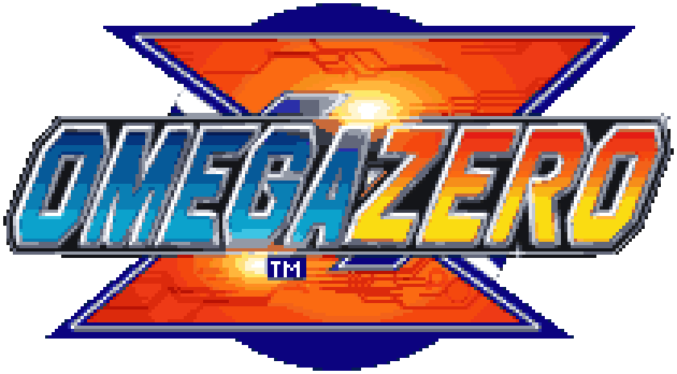</h1>

A Game Boy-centric frontend for Anbernic H700 handhelds running
<a href="https://github.com/pvaibhav/BaseOS">BaseOS</a>. It plays GBA, GBC and GB games, and SNES
and PlayStation games too, on a shelf of cartridges and discs that go down into the handheld when
you play them.

<a href="https://oauramos.github.io/omega-zero/"><b>Site</b></a> ·
<a href="https://github.com/oauramos/omega-zero/releases/latest"><b>Download</b></a> ·
<a href="https://github.com/oauramos/omega-zero/wiki"><b>Wiki</b></a> ·
<a href="CHANGELOG.md"><b>Changelog</b></a>

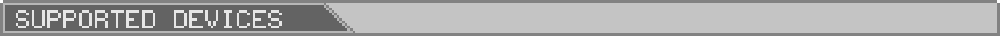

## Supported devices

One build runs on all of them: omega-zero reads the model from BaseOS at boot and lays itself out
for its panel.

| Device | Panel | Status |
|---|---|---|
| RG35XX SP | 640x480 | Main target, in daily use |
| RG SP | 720x480 | Supported, not yet retested on hardware |
| RG34XX SP, RG34XX | 720x480 | Untested |
| RG35XX Plus / 2024, H, Pro | 640x480 | Untested |
| RG40XX H, RG40XX V | 640x480 | Untested |
| RG CubeXX | 720x720 | Experimental |
| RG28XX | 480x640, turned | Experimental |

Own an untested one? A [device report](https://github.com/oauramos/omega-zero/wiki/Device-Reports)
is the most useful thing you can send.

## Highlights

- A shelf for each system, modelled low-poly and drawn the way a PlayStation drew 3D, with real
  label scans: Game Boy carts in their own plastics, SNES carts in the American shape for a game
  from the USA and the Super Famicom's for the rest, and PlayStation discs, a game on several
  discs standing as a stack of them. The one you are on floats and sways; A pulls it down out of
  the screen into the handheld, and the game comes on like a tube TV. This edition skips the frontend
  intro and restores the last menu selection, resuming only a game active at shutdown.
- Six cores: mGBA and gpSP for the GBA and Snes9x and Supafaust for the SNES, chosen per cart;
  Gambatte (or mGBA) for the Game Boys; PCSX ReARMed for the PlayStation, with a BIOS of its own built in. GBA
  uses its original layout; consoles and Game Boy have selectable scaling modes.
- A PlayStation game on several discs is one game: DISC, on SELECT+MENU in a game, puts another
  disc in, and the game resumes with the disc that was in the drive.
- Resume on boot, save states with a switcher, rewind (not on the PlayStation), fast-forward,
  and turbo buttons on the Game Boys.
- Link play between two handhelds over Wi-Fi, for Game Boy and GBA games: Pokémon trades,
  Advance Wars, Mario Kart and Tetris.
- Settings on START, in windows in the style of Mega Man Zero's menus that slide from screen to
  screen, over a background that keeps moving: CONFIGS (Fast Forward, Fast Forward Sound, Colour
  Correction, Rumble, Labels) and GENERAL (Date & Time, Network, Bluetooth, Theme, About).
- A tap of SELECT opens CONTROLS: what every button does, on the shelf and in a game, on one panel.
- Network: home Wi-Fi, network time, and SSH and SFTP, each ON or OFF. Y on one opens its panel:
  SSH's shows the login and root's own random password. Labels are fetched from ScreenScraper,
  one for each disc of a PlayStation game.
- Bluetooth, on handhelds that have it: pair a device and connect it, or forget it. Game sound and
  gamepads over Bluetooth are still to come.
- Theme: the background's pattern, its motion and its colour, which the menus and both bars take
  (Night is grey, Amber is Mega Man Zero's own), and the bottom bar's font, Bold or Thin.
- A pixel font, a top bar with the radios, clock and battery, and a bottom bar with the buttons.

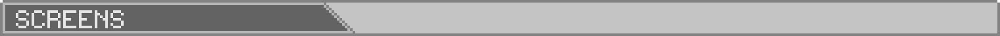

## Screens

<a href="https://oauramos.github.io/omega-zero/">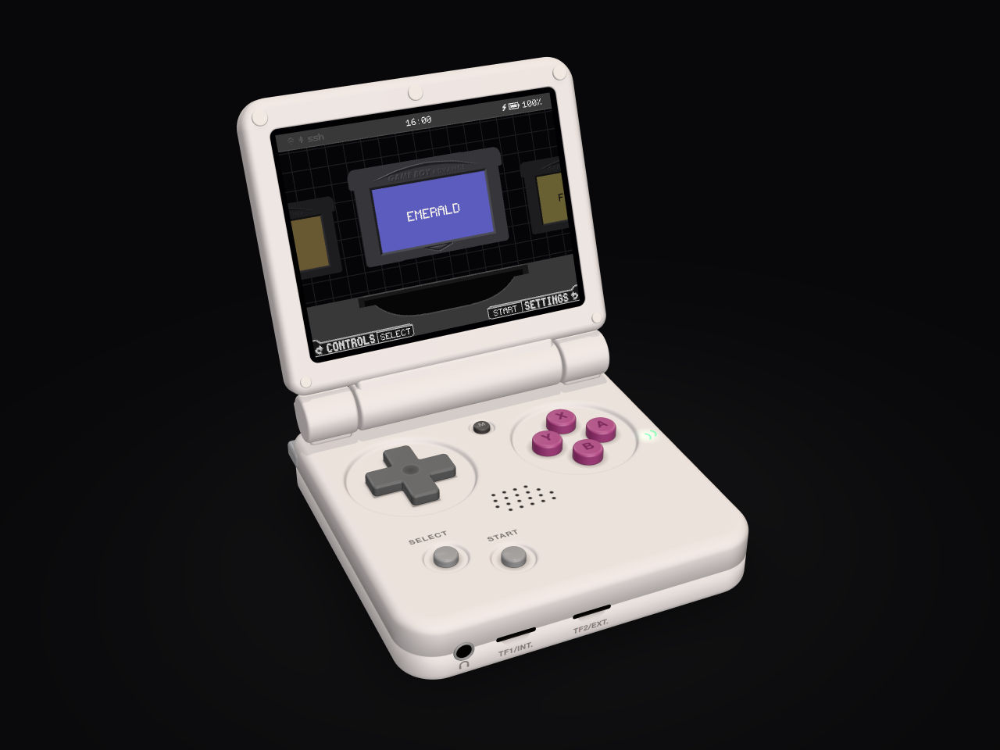</a>
 The RG35XX SP in 3D, drawn the way a PlayStation drew it, with omega-zero's own screens on it: the loops play on the <a href="https://oauramos.github.io/omega-zero/">site</a>

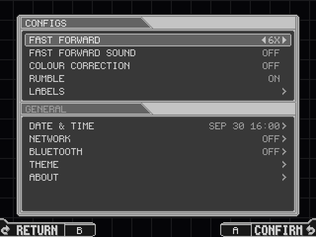
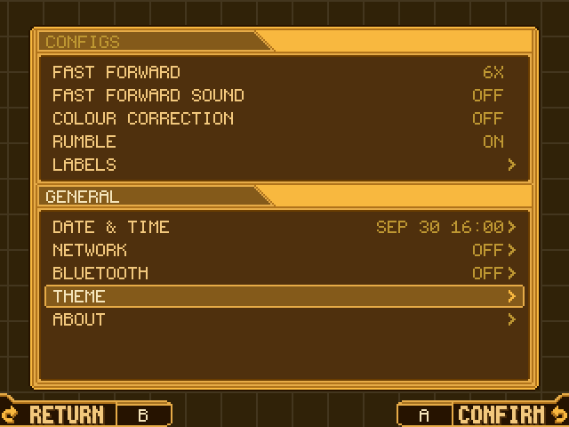
 Settings, in Night and in Amber

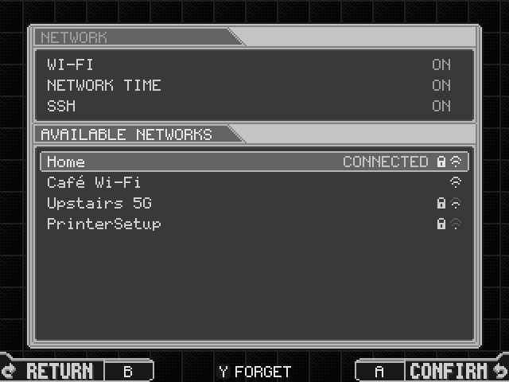
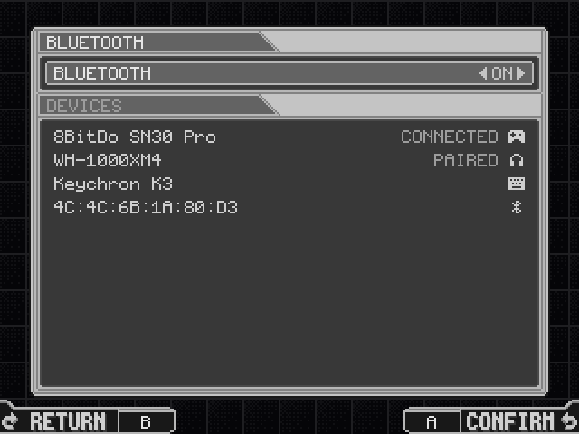
 Network and Bluetooth

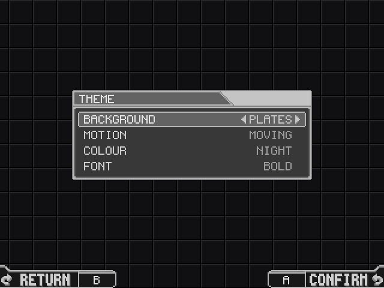
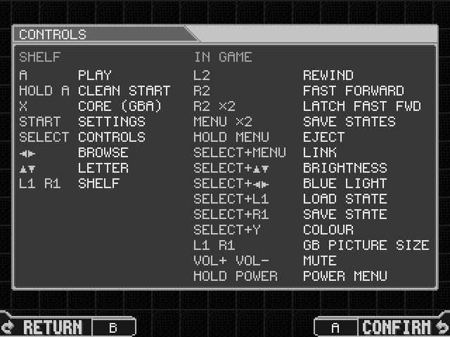
 Theme, and CONTROLS on a tap of SELECT

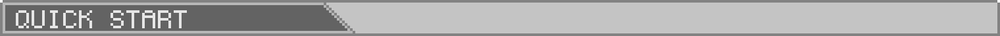

## Quick start

1. Write the [BaseOS image](https://github.com/pvaibhav/BaseOS/releases/latest) for your model to a
   microSD card, put it in **SD1** and boot once.
2. Copy the contents of the [latest release](https://github.com/oauramos/omega-zero/releases/latest)
   to the root of that card.
3. Put your games in `Games/GBA`, `Games/GB`, `Games/GBC`, `Games/SNES` and `Games/PS1`. A
   PlayStation game is a `.cue` with its `.bin`, a `.chd`, a `.pbp` or an `.m3u`; a real
   PlayStation BIOS, such as `scph5501.bin`, is used from `BIOS/` when it is there.
4. Boot. On the shelf, START opens Settings and a tap of SELECT shows every button.

Two cards and updating are in the site's
[install guide](https://oauramos.github.io/omega-zero/#install); controls and everything else are
in the [wiki](https://github.com/oauramos/omega-zero/wiki).

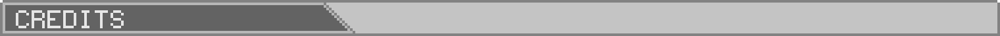

## Credits and licence

omega-zero is made by **Otávio ([@oauramos](https://github.com/oauramos))**.

- Based on [slot](https://github.com/BrandonKowalski/slot) by
  [Brandon T. Kowalski](https://github.com/BrandonKowalski) (GPL-3.0). The code that hosts the
  cores, with their saves, sound and input, is still largely his.
- [BaseOS](https://github.com/pvaibhav/BaseOS) by pvaibhav.
- Emulation by [mGBA](https://mgba.io) (MPL-2.0) and [gpSP](https://github.com/libretro/gpsp)
  (GPL-2.0) for the Game Boys; [Snes9x](https://github.com/libretro/snes9x) (free for
  non-commercial use only) and [Supafaust](https://github.com/libretro/supafaust), Mednafen's
  snes_faust (GPL-2.0), for the SNES; and
  [PCSX ReARMed](https://github.com/libretro/pcsx_rearmed) (GPL-2.0) for the PlayStation. Their
  licences and patches, and the source of all but mGBA, ship in `System/licenses/`.
- Type is [Pixel Code](https://github.com/qwerasd205/PixelCode) by Qwerasd (SIL OFL 1.1); every
  icon is drawn as pixel art. The LCD mask is derived from GigaHerz's LCD3x.
- Cart labels come from [ScreenScraper](https://www.screenscraper.fr), fetched with your own
  account.

omega-zero is licensed under the GPL-3.0-or-later; see [LICENSE](LICENSE). It began in October
2026 as a modified version of slot. It is written with Claude, and reviewed and tested by its
maintainer. The site and these pictures are drawn with its
UI kit, [`assets/ui`](assets/ui).

Game Boy, Game Boy Color, Game Boy Advance, Super Nintendo Entertainment System and Super Famicom
are trademarks of Nintendo. PlayStation is a trademark of Sony Interactive Entertainment. Anbernic
is a trademark of its owner. This project is not affiliated with any of them.
