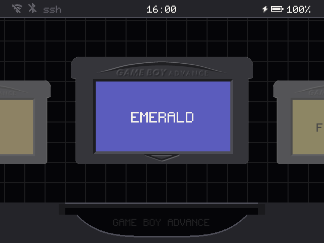

# omega-zero

A Game Boy-centric frontend for Anbernic H700 handhelds running
[BaseOS](https://github.com/pvaibhav/BaseOS). It plays GBA, GBC and GB games, and only those, on a
shelf of cartridges you slide into a slot.

**[Site](https://oauramos.github.io/omega-zero/)** ·
**[Download](https://github.com/oauramos/omega-zero/releases/latest)** ·
**[Wiki](https://github.com/oauramos/omega-zero/wiki)** ·
**[Changelog](CHANGELOG.md)**

## Supported devices

One build runs on all of them: omega-zero reads the model from BaseOS at boot and lays itself out
for its panel.

| Device | Panel | Status |
|---|---|---|
| RG35XX SP | 640x480 | Main target, in daily use |
| RG SP | 720x480 | Supported, not yet retested on hardware |
| RG34XX SP, RG34XX | 720x480 | Untested |
| RG35XX Plus / 2024, H, Pro | 640x480 | Untested |
| RG40XX H, RG40XX V | 640x480 | Untested |
| RG CubeXX | 720x720 | Experimental |
| RG28XX | 480x640, turned | Experimental |

Own an untested one? A [device report](https://github.com/oauramos/omega-zero/wiki/Device-Reports)
is the most useful thing you can send.

## Highlights

- A shelf of solid carts in their own plastics with real label scans. The one you are on floats
  and sways, and slides into the slot at full size.
- Two GBA cores, mGBA and gpSP, chosen per cart. GBA fills a 640x480 screen; Game Boy stays at 3x.
- Resume on boot, save states with a switcher, rewind, fast-forward, turbo buttons.
- Link play between two handhelds over Wi-Fi, for Pokémon trades, Advance Wars, Mario Kart and Tetris.
- Settings on START, in windows in the style of Mega Man Zero's menus that slide from screen to
  screen. A tap of SELECT lists what every button does.
- Home Wi-Fi with SSH and SFTP (switched on and off in Network, the login and root's own random
  password shown on screen), network time, and cart labels fetched from ScreenScraper.
- A pixel font, a top bar with the radios, clock and battery, a bottom bar with the buttons, and
  a background you choose, whose colour the menus take.

## Quick start

1. Write the [BaseOS image](https://github.com/pvaibhav/BaseOS/releases/latest) for your model to a
   microSD card, put it in **SD1** and boot once.
2. Copy the contents of the [latest release](https://github.com/oauramos/omega-zero/releases/latest)
   to the root of that card.
3. Put your games in `Games/GBA`, `Games/GB` and `Games/GBC`.
4. Boot. On the shelf, START opens Settings and a tap of SELECT shows every button.

Two cards, updating, controls and everything else are in the
[wiki](https://github.com/oauramos/omega-zero/wiki).

## Credits and licence

- omega-zero is based on [slot](https://github.com/BrandonKowalski/slot) by
  [Brandon T. Kowalski](https://github.com/BrandonKowalski), released under the GPL-3.0: the
  shelf, the carts, their sounds and much of the code began there, and have been modified since
  October 2026.
- [BaseOS](https://github.com/pvaibhav/BaseOS) by pvaibhav.
- Emulation by [mGBA](https://mgba.io) (MPL-2.0) and [gpSP](https://github.com/libretro/gpsp)
  (GPL-2.0). Their licences, patches and gpSP's source ship in `System/licenses/`.
- Type is [Pixel Code](https://github.com/qwerasd205/PixelCode) by Qwerasd (SIL OFL 1.1) and the
  [Nerd Fonts](https://www.nerdfonts.com) symbols. The LCD mask is derived from GigaHerz's LCD3x.
- Cart labels come from [ScreenScraper](https://www.screenscraper.fr), fetched with your own
  account.

omega-zero is licensed under the GPL-3.0-or-later; see [LICENSE](LICENSE). It is written with
Claude, and reviewed and tested by its maintainer.

Game Boy, Game Boy Color and Game Boy Advance are trademarks of Nintendo. Anbernic is a trademark
of its owner. This project is not affiliated with either.
